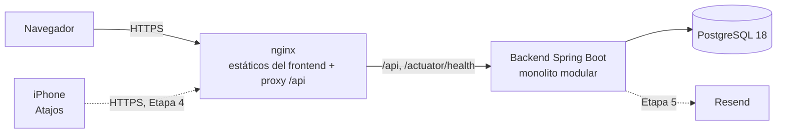
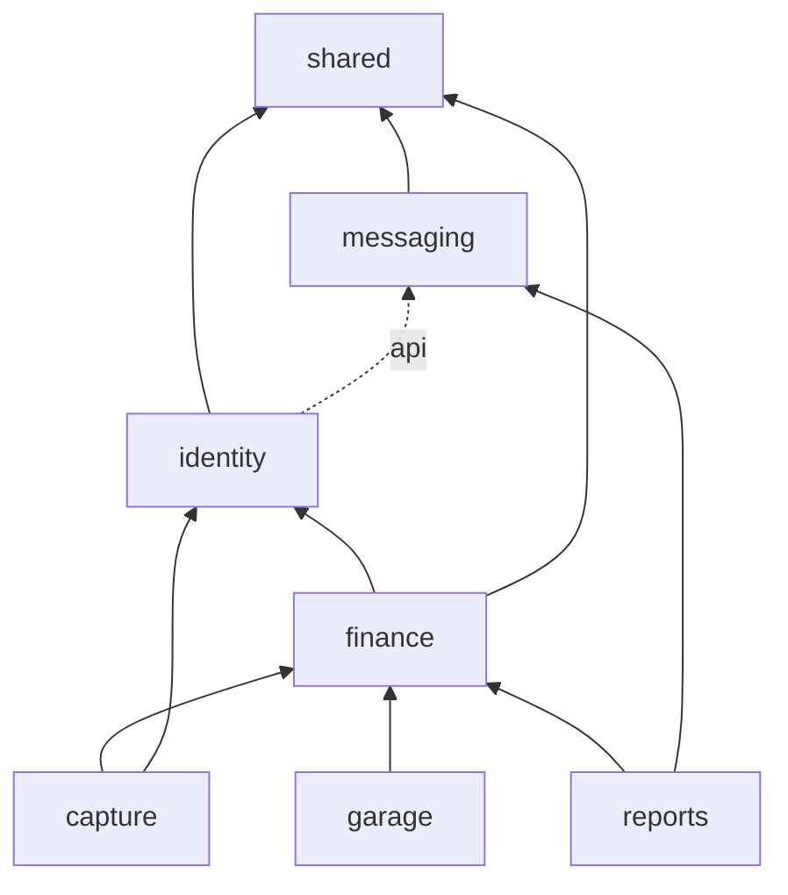

# Visión general de la arquitectura

## Contexto

Personal Tracker es una aplicación web de gestión personal. El MVP cubre **finanzas**: registro manual, captura automática de notificaciones bancarias desde el iPhone y reportes programados. Más adelante se agregará el **garaje** (vehículos). Cada usuario tiene información completamente aislada.



- **Mismo origen.** El frontend y la API se publican bajo el mismo dominio: en desarrollo, con el proxy de Vite; en contenedores y producción, con nginx. Así las cookies de sesión funcionan con `SameSite` y no hace falta abrir CORS ([ADR-0007](../decisions/0007-topologia-mismo-origen-y-cors.md)).
- **Un solo despliegue y una sola base de datos.** No hay microservicios ni brokers ([ADR-0001](../decisions/0001-monolito-modular-hexagonal.md)).

## Monolito modular

Cada subpaquete directo de `com.personaltracker` es un módulo de negocio con límites verificados por Spring Modulith. Ver [modules.md](modules.md).



Hoy existen `shared`, `identity` y `finance` (en construcción). Los demás módulos se crean en su etapa ([ADR-0016](../decisions/0016-modulos-capture-y-messaging.md)).

## Arquitectura hexagonal dentro de cada módulo

```text
<modulo>/
├── package-info.java     @ApplicationModule: dependencias permitidas
├── api/                  contrato público para otros módulos (@NamedInterface)
├── domain/               modelo y reglas de negocio — Java puro
├── application/
│   ├── usecase/          una clase por operación de negocio (puerto de entrada)
│   ├── port/out/         puertos de salida: repositorios y servicios externos
│   └── dto/              comandos y resultados
└── infrastructure/
    ├── web/              controladores REST delgados
    ├── persistence/      entidades JPA, Spring Data, adaptadores y mappers
    └── config/
```

Las dependencias van de afuera hacia adentro: `infrastructure` depende de `application`, y `application` de `domain`. Las convenciones completas están en [ADR-0002](../decisions/0002-convenciones-de-capas-y-puertos.md).

### Cómo se hacen cumplir las reglas

| Regla | Verificación |
|---|---|
| Sin ciclos entre módulos ni acceso a sus partes internas | `ModularityTests`: `ApplicationModules.verify()` |
| Dominio sin Spring, JPA, Hibernate ni Jackson | `HexagonalArchitectureTests` |
| La aplicación no depende de la infraestructura y solo usa `@Service`/`@Component` y `@Transactional` de Spring | `HexagonalArchitectureTests` |
| Los controladores no acceden a la persistencia | `HexagonalArchitectureTests` |
| Entidades JPA solo en `infrastructure.persistence` | `HexagonalArchitectureTests` |
| Sin `float`/`double` en dominio, aplicación ni API | `HexagonalArchitectureTests` |

Las pruebas corren en cada `./mvnw verify` y en CI. Si una regla falla, se corrige el código; las reglas no se debilitan.

## Aspectos transversales

| Aspecto | Implementación |
|---|---|
| Errores | `GlobalExceptionHandler` devuelve `application/problem+json` con un `code` estable y un mensaje en español. Ver [ADR-0008](../decisions/0008-errores-problem-detail.md) y [convenciones de la API](../api/conventions.md). |
| Seguridad | Todo se deniega por defecto. Solo son públicos `/actuator/health/**` y Swagger, este último únicamente en el perfil local. Las respuestas 401/403 usan el mismo formato de error. La autenticación por sesión llega en la Etapa 2 ([ADR-0004](../decisions/0004-autenticacion-por-sesion.md)). |
| Aislamiento de datos | El propietario sale siempre de la sesión y las consultas filtran por él. En la base de datos se usan llaves foráneas compuestas ([ADR-0003](../decisions/0003-aislamiento-por-propietario.md)). |
| Correlación | `CorrelationIdFilter` asigna `X-Correlation-Id`, lo registra en los logs y lo incluye en los errores. |
| CORS | Lista explícita de orígenes en `CORS_ALLOWED_ORIGINS`, vacía por defecto. |
| Persistencia | Un esquema PostgreSQL por módulo. Flyway es dueño del esquema y Hibernate solo valida ([ADR-0005](../decisions/0005-persistencia-esquemas-flyway-uuid.md)). |
| Dinero y fechas | `BigDecimal` y `NUMERIC(19,2)`; montos como cadenas en JSON; `LocalDate` para fechas de negocio ([ADR-0006](../decisions/0006-dinero-y-fechas.md)). |
| Documentación de la API | springdoc-openapi, solo en el perfil `local`. |
| Operación | Actuator con `/actuator/health`, `/liveness` y `/readiness`; logs estructurados (ECS) en `prod`. |

## Diagramas de módulos generados

`./mvnw verify` genera diagramas PlantUML y documentación AsciiDoc de los módulos en `target/spring-modulith-docs/`, a partir del código real.
